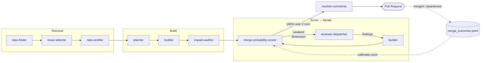

<div align="center">

<a href="https://superhuman-oss.com"></a>

# superhuman

### Merged PRs, while you're doing something else.

An open-source contribution agent for [Claude Code](https://claude.com/claude-code) and Codex.<br>
It picks an issue, writes the fix, scores its own pull request the way a maintainer would, and iterates until it's good enough to merge.

[](https://github.com/gaurav0107/superhuman/releases)
[](https://github.com/gaurav0107/superhuman/actions/workflows/tests.yml)
[](./LICENSE)
[](#supported-runtimes)
[](https://superhuman-oss.com)
[](https://github.com/gaurav0107/superhuman/stargazers)

**[Quick start](#quick-start)** · **[How it works](#the-loop)** · **[Proven on](#proven-on)** · **[Install](#installation)** · **[Commands](#commands)** · **[Safety](#safety-rails)** · **[FAQ](#faq)**

</div>

<br>

<div align="center">

| 259 | 115 | 46 |
|:---:|:---:|:---:|
| pull requests opened | merged by maintainers | repositories |

<sub>Open-source repos with 1,000+ stars, since April 2026 (as of 2026-11-17).</sub>

Merged into [Deno](https://github.com/denoland/deno/pull/36321), [ClickHouse](https://github.com/ClickHouse/ClickHouse/pull/106916), [Envoy](https://github.com/envoyproxy/envoy/pull/45510), [Keycloak](https://github.com/keycloak/keycloak/pull/50809), [Apache Superset](https://github.com/apache/superset/pull/42489), [MLflow](https://github.com/mlflow/mlflow/pull/23488), [LlamaIndex](https://github.com/run-llama/llama_index/pull/21891), [Gitea](https://github.com/go-gitea/gitea/pull/38479), [Starship](https://github.com/starship/starship/pull/7497), [Pydantic AI](https://github.com/pydantic/pydantic-ai/pull/5681), [Oxc](https://github.com/oxc-project/oxc/pull/22752), [Unsloth](https://github.com/unslothai/unsloth/pull/7113), [Tesseract](https://github.com/tesseract-ocr/tesseract/pull/4563), [Ant Design](https://github.com/ant-design/ant-design/pull/58241), and more.

</div>

## Quick start

```bash
curl -fsSL https://raw.githubusercontent.com/gaurav0107/superhuman/main/install.sh | bash
```

Then, in Claude Code:

```text
/repo-finder      build a shortlist of repos worth contributing to
/contribute       pick an issue, write the fix, open a pull request
```

That's it. It forks into your account, pushes only to your fork, and opens the PR under your name. Needs `gh` (authenticated), `git` and `jq`; the full walkthrough, Codex setup and troubleshooting are under [Installation](#installation).

## The loop

Most agent tools are **open-loop**: generate once, hope it's good. superhuman is **closed-loop**. It scores its own pull request before opening it, finds the single weakest dimension, spends an iteration fixing exactly that, re-scores, and repeats until it converges. It's gradient descent on one objective — *will a maintainer merge this?* — with a prior learned from every past outcome.

| 01 · Score | 02 · Target | 03 · Fix | 04 · Repeat |
|---|---|---|---|
| A 10-dimension rubric grades the PR the way a maintainer would. | The single weakest dimension. Nothing else. | Routed to the matching language specialist. | Until 95% merge probability, two runs in a row. |



Four ideas make the loop converge instead of wander:

1. **Self-evaluation before submission.** `merge-probability-scorer` is a critic with a 10-dimension weighted rubric — correctness, tests, style, PR format, process compliance, scope, docs, commit hygiene, risk, and historical signal. The agent grades its own work the way a maintainer would, *before* spending the maintainer's attention.
2. **Targeted iteration, not random polish.** Each round, `reviewer-dispatcher` picks the single **weakest non-plateaued dimension** and routes it to the matching language specialist (python / go / ts / java / kotlin / rust / cpp / csharp / flutter / security). Effort goes where it moves the score most. Plateau detection stops the loop from grinding a dimension that won't improve.
3. **Bounded compute, real convergence.** The loop stops at **95% merge probability sustained over two consecutive runs**, and the iteration budget is **capped adaptively by diff size** (3 / 6 / 10). It terminates — by quality or by budget — every time.
4. **A prior that learns.** Every run appends to `~/.superhuman/global/merge_outcomes.jsonl`, and `/contribution-sweep` later records whether each PR was actually merged or closed. Those outcomes calibrate the scorer's historical-signal dimension. The system carries a better prior into the next repo than it had on the last one.

## Proven on

superhuman has authored merged pull requests into repositories it doesn't own, across Python, Rust, TypeScript, Kotlin, and C++:

| Repository | PR | Fix |
|---|---|---|
| [huggingface/transformers](https://github.com/huggingface/transformers/pull/45611) | #45611 | Clear error for `problem_type="single_label_classification"` with `num_labels=1` |
| [apache/airflow](https://github.com/apache/airflow/pull/65685) | #65685 | Honor `AUTH_ROLE_PUBLIC` in the FastAPI API server |
| [google-gemini/gemini-cli](https://github.com/google-gemini/gemini-cli/pull/25822) | #25822 | Missing response key in custom theme text schema |
| [ant-design/ant-design](https://github.com/ant-design/ant-design/pull/58241) | #58241 | Apply `labelStyle`/`contentStyle` to bordered `Descriptions` cells |
| [oxc-project/oxc](https://github.com/oxc-project/oxc/pull/23015) | #23015 | `jsx-a11y/no-redundant-roles` attribute-aware implicit roles |
| [pydantic/pydantic-ai](https://github.com/pydantic/pydantic-ai/pull/5681) | #5681 | Fix `GoogleModelSettings.google_cached_content` request shaping |
| [Lightning-AI/pytorch-lightning](https://github.com/Lightning-AI/pytorch-lightning/pull/21686) | #21686 | Fix `torch.compile` breaking `toggle_optimizer`/`untoggle_optimizer` |
| [tesseract-ocr/tesseract](https://github.com/tesseract-ocr/tesseract/pull/4563) | #4563 | Fix crash when LSTM is missing in a disabled-legacy build |
| [affaan-m/ECC](https://github.com/affaan-m/ECC/pull/2161) | #2161 | Configurable env guards for the destructive-command bash gate |

Plus merges into [run-llama/llama_index](https://github.com/run-llama/llama_index/pull/21891), [mem0ai/mem0](https://github.com/mem0ai/mem0/pull/5202), [langchain4j](https://github.com/langchain4j/langchain4j/pull/5272), [lima-vm/lima](https://github.com/lima-vm/lima/pull/5090), [danny-avila/LibreChat](https://github.com/danny-avila/LibreChat/pull/13171), and [mochajs/mocha](https://github.com/mochajs/mocha/pull/6016).

A merged PR into `transformers` or the `oxc` Rust linter is not a demo. It's the loop working.

## The harness

A loop that opens PRs into other people's repos, unattended, is only safe if the machinery underneath is disciplined. The harness is the part that lets the loop run without a human babysitting it:

- **Contracts, not vibes.** [`agents/SHARED_STATE.md`](./agents/SHARED_STATE.md) is a single source of truth for who writes each state file and who reads it — a concurrency contract that lets parallel runs share `~/.superhuman/` without corrupting it.
- **Typed state.** Every shared-state file has a [JSON Schema](./schemas/) (draft 2020-12), validated at write time. State is data with a shape, not a free-for-all.
- **Behavior split from shell.** Reasoning and safety prose live in agent prompts (`agents/*.md`); the deterministic `bash`/`jq` lives in versioned, unit-tested [`scripts/`](./scripts). Bash unit tests cover every script and schema, on macOS and Linux CI.
- **Blast-radius auditing.** `impact-auditor` runs before any refactor to a shared function — it blocks the class of change that's correct in one execution context (Flask request time) and fatal in another (FastAPI startup).
- **Hard safety rails.** Allowlisted CI commands only, `--force-with-lease` to a fork (never upstream, never plain `--force`), and a prompt-injection halt on any review comment that tries to make the agent run shell or fetch external URLs. See [Safety rails](#safety-rails).

Orchestrator + 10 specialists + 1 shared-state contract. The orchestrator is thin: it owns the lock, sequences the phases, and enforces the cap and the threshold. The intelligence is in the specialists and the loop.

## Installation

### Requirements

| Requirement | Why | Install |
|---|---|---|
| [Claude Code](https://claude.com/claude-code) or Codex | The runtime the agents run in. | See the Claude Code / Codex docs |
| [`gh`](https://cli.github.com/), authenticated | Forks repos, opens PRs, reads issues and reviews. Run `gh auth login` before your first contribution. | `brew install gh` |
| `git` | Branches, commits, `--force-with-lease` pushes to your fork. Commits are authored as you. | preinstalled / `brew install git` |
| [`jq`](https://jqlang.github.io/jq/) | Every read and write of the state under `~/.superhuman/`. | `brew install jq` |
| `python3` + `jsonschema` | Validates state files against their schemas. The installer adds `jsonschema` for you. | preinstalled / `python3 -m pip install jsonschema` |
| [`superpowers`](https://github.com/obra/superpowers) plugin | **Required.** `planner` and `builder` call its skills and fail with `PluginMissingError` without it. | Installed by `install.sh` |
| `everything-claude-code` (ECC) plugin | Recommended. Language-specialist reviewers; without it review falls back to inline prompts and quality drops. | Installed by `install.sh` (skip with `--skip-ecc`) |

Supported on **macOS and Linux** (both CI-tested). On Windows, use WSL2 (not CI-tested).

> **Your GitHub account opens the PRs.** superhuman forks into your account, pushes only to your fork (never upstream, never plain `--force`), and opens PRs under your name. See [Safety rails](#safety-rails).

### Install

One command installs superhuman and its plugin dependencies through the Claude Code CLI. It checks prerequisites first and is safe to re-run:

```bash
curl -fsSL https://raw.githubusercontent.com/gaurav0107/superhuman/main/install.sh | bash
```

Prefer to read it first:

```bash
curl -fsSL https://raw.githubusercontent.com/gaurav0107/superhuman/main/install.sh -o install.sh
bash install.sh --dry-run
```

| Flag | Effect |
|---|---|
| `--skip-ecc` | Skip `everything-claude-code` (the optional reviewer plugin). |
| `--codex` | Also install for Codex (clones the repo to `~/src/superhuman` and links the skill). |
| `--dry-run` | Print the commands without running them. |

Then restart Claude Code (or run `/reload-plugins`).

<details>
<summary><b>Manual install (inside Claude Code)</b></summary>

```text
/plugin marketplace add https://github.com/obra/superpowers-marketplace
/plugin install superpowers@superpowers-marketplace

/plugin marketplace add https://github.com/affaan-m/everything-claude-code
/plugin install ecc@ecc

/plugin marketplace add https://github.com/gaurav0107/superhuman
/plugin install superhuman@superhuman

/reload-plugins
```

</details>

<details>
<summary><b>Codex</b></summary>

Codex has no plugin marketplace yet. `install.sh --codex` does this for you, or by hand:

```bash
git clone https://github.com/gaurav0107/superhuman ~/src/superhuman
ln -s ~/src/superhuman/skills/superhuman ~/.codex/skills/superhuman
```

Then ask Codex: `Use the superhuman skill to find a good open-source repo and contribute.` Codex has no slash commands; see [Codex command equivalents](#codex-command-equivalents).

</details>

### Verify

```bash
claude plugin list          # superhuman and superpowers should both be listed
gh auth status              # must show you logged in
```

In Claude Code, `/contribution-dashboard` should print an empty dashboard rather than "unknown command".

### Your first contribution

1. **Tell it what you like** (optional, once): `/preferences`. Without it, a default profile is used. See [Usage](#usage).
2. **Build a shortlist** of repos worth contributing to: `/repo-finder`.
3. **Contribute**: `/contribute`. It picks an eligible repo and issue, forks the repo into your account, clones it into `~/.superhuman/work/`, plans, builds, and opens a **draft** PR. It iterates on the draft until the self-score converges, and marks it ready for review once the score reaches 80%.
4. **Come back later**: `/contribution-sweep` records which PRs were merged or closed and lists the open ones that need you (review changes requested, merge conflict, failing CI).

Prefer to choose the target yourself: `/contribute owner/repo` or `/contribute owner/repo 1234`.

### Update

```bash
claude plugin marketplace update superhuman
claude plugin update superhuman@superhuman
```

Restart Claude Code to load the new version. For Codex: `git -C ~/src/superhuman pull`. Release notes are in [CHANGELOG.md](./CHANGELOG.md).

### Uninstall

```bash
claude plugin uninstall superhuman@superhuman
claude plugin marketplace remove superhuman
rm ~/.codex/skills/superhuman          # only if you installed for Codex
```

This keeps your history in `~/.superhuman/` (outcomes, lessons, preferences, clones). Delete that folder to remove everything, and remove any crontab entries you added from [Running on a schedule](#running-on-a-schedule-optional). Forks created on GitHub stay in your account.

### Troubleshooting

| You see | What it means / fix |
|---|---|
| `PluginMissingError` from `planner` or `builder` | `superpowers` isn't installed: `claude plugin install superpowers@superpowers-marketplace`, then restart. |
| Slash commands missing after install | Restart Claude Code or run `/reload-plugins`. |
| `No repo-shortlist.json` | Run `/repo-finder` first, or name a repo: `/contribute owner/repo`. |
| `gh is not authenticated` / HTTP 401 | `gh auth login`. |
| `LOCKED: owner/repo` | Another run is working on that repo. A crashed run's lock frees itself after `SUPERHUMAN_LOCK_TTL_HOURS` (6h). |
| `COOLDOWN: owner/repo until …` | Recent PRs there were rejected or abandoned; the repo is skipped until that date. |
| `OPEN_PR_CAP` | You already have `SUPERHUMAN_MAX_OPEN_PRS_PER_REPO` open PRs there. `/contribution-sweep` lists them. |
| `DAILY_CAP` | `SUPERHUMAN_MAX_PRS_PER_DAY` PRs were opened in the last 24h. Wait, or raise the cap. |
| `validate_json: WARN: python3 jsonschema not available` | `python3 -m pip install jsonschema` for full schema validation. |

Still stuck? [Open an issue](https://github.com/gaurav0107/superhuman/issues) with the command you ran and its output. Security problems go through [SECURITY.md](./SECURITY.md), not public issues.

## Supported runtimes

| Runtime | Entry point | Notes |
|---|---|---|
| Claude Code | `.claude-plugin/` | Loads `agents/` as subagents and `commands/` as slash commands. |
| Codex | `.codex-plugin/` | Loads `skills/superhuman/SKILL.md`, which adapts the same `agents/`, `scripts/`, and `schemas/` contracts for inline execution. |

Claude Code dispatches `Agent(subagent_type=...)` calls. Codex executes the same agent contracts inline by reading the referenced files under `agents/`.

### Codex command equivalents

Codex does not have slash commands. Use these prompts to invoke the same workflows the Claude Code commands trigger:

| Claude Code command | Codex prompt |
|---|---|
| `/contribute` | `Use the superhuman skill to find a good open-source repo and contribute.` |
| `/contribute owner/repo` | `Use the superhuman skill to contribute to owner/repo.` |
| `/contribute owner/repo 123` | `Use the superhuman skill to contribute to owner/repo issue #123.` |
| `/contribute-loop [N]` | `Use the superhuman skill to run N sequential contributions, stopping on suspicious_halt or crash.` |
| `/contribution-fleet [N]` | Not supported in Codex — fleet runs require parallel subagent dispatch. Run sequential loops instead. |
| `/contribution-dashboard [owner/repo]` | `Use the superhuman skill to show the contribution dashboard for owner/repo (or all repos if omitted).` |
| `/contribution-sweep` | `Use the superhuman skill to sweep my open superhuman PRs.` |
| `/repo-finder [N]` | `Use the superhuman skill to refresh my open-source repo shortlist with up to N candidates.` |
| `/preferences` | `Use the superhuman skill to set my repo search preferences.` |
| `/preferences --show` | `Use the superhuman skill to show my repo search preferences and the queries they compile to.` |

## Usage

**Tell it what you want to work on** — run `/preferences` once. Without it, the scan uses a default profile (AI/ML, Java, Python, dev-tools, >20K stars), which is fine but is not *yours*:

```text
/preferences
```

It asks four things — languages, topics, a star floor, and anything else in your own words — then writes `~/.superhuman/preferences.md`:

```markdown
## Filters
languages: go, rust
topics: backend, infrastructure, llm:5000, any
stars: 2000

## Notes
Prefer small focused libraries over sprawling frameworks.
I'd rather fix bugs than add features — feature work invites bikeshedding.
Nothing that needs a GPU to run the test suite.
```

The two halves do different jobs, and the split is deliberate:

- **`## Filters` is mechanical.** It compiles 1:1 into GitHub search qualifiers. "Only Go and Rust" means only Go and Rust. `topic[:min_stars]` gives one topic its own floor (`llm:5000`); `any` is reserved and means "…plus repos carrying none of these tags"; `stars` is a **floor**, and there is no ceiling.
- **`## Notes` is prose.** Nothing can hard-filter on "focused rather than sprawling", so the agent applies your notes where judgment actually happens — breaking ties between repos, and choosing which issue to fix — and it tells you in the shortlist's `notes` field when your prose drove the pick. It never touches a score.

You can edit the file by hand; it is yours. `/preferences --show` prints it back along with the exact queries it compiles to, so a filter is never opaque:

```text
Your next /repo-finder will search:
  q='language:go language:rust topic:backend        stars:>2000 archived:false'
  q='language:go language:rust topic:infrastructure stars:>2000 archived:false'
  q='language:go language:rust topic:llm            stars:>5000 archived:false'
  q='language:go language:rust                      stars:>2000 archived:false'
```

One query per topic — languages are free (they union inside a single query, so adding one costs nothing). To deviate for a single run without touching the saved file:

```text
/repo-finder 5 --lang rust --topic cli
```

**Single run** — let it pick the repo and issue, or name them:

```text
/contribute
/contribute apache/airflow
/contribute apache/airflow 65685
```

**Several in a row** — stops early on a prompt-injection halt or crash:

```text
/contribute-loop 3
```

**Parallel fleet** — run N independent contributions concurrently:

```
/contribution-fleet 3
/contribution-fleet apache/airflow langchain-ai/langchain pytorch/pytorch
```

Each fleet run gets its own state dir, clone path, and `flock(2)` mutex — they cannot interfere.

**Dashboard** — read-only view of live runs, score history, iteration caps, and merge outcomes:

```text
/contribution-dashboard
/contribution-dashboard apache/airflow
```

**Sweep** — record what happened to your open PRs and list the ones that need you:

```text
/contribution-sweep
```

## Agents

Orchestrator + 10 specialists + 1 shared-state contract document.

| Agent | Role |
|---|---|
| `opensource-contributor` | Thin orchestrator. Owns the `current_contribution.json` lock, sequences phases, enforces the iteration cap and merge threshold. |
| `repo-finder` | Discovers high-value repos worth contributing to. |
| `issue-selector` | Filters and ranks open issues; writes `issue_candidates.json`. |
| `repo-profiler` | Extracts contribution conventions from merged PRs; writes `repo_profile.json`, `ci_commands.json`, `allowed_commands.json`. |
| `planner` | Wraps `superpowers:writing-plans` with repo context; writes `plan.md`. |
| `builder` | Wraps `superpowers:subagent-driven-development`; runs impact-audit and local CI gates. |
| `impact-auditor` | Refactor blast-radius auditor. Blocks reviewer-suggested refactors that break one caller to fix another. |
| `merge-probability-scorer` | 10-dimension weighted rubric blended with historical merge outcomes. |
| `reviewer-dispatcher` | Picks the weakest dimension and routes to the right specialist reviewer. |
| `resolve-comments` | Classifies PR review comments; drafts replies or dispatches fixes. Halts on prompt-injection. |
| `lesson-distiller` | Producer/curator of the durable knowledge base. Seeds the repo dossier + scan rule cards; mines reviewer feedback and merge outcomes into typed rule cards; runs cross-repo promotion, decay, and contradiction-demotion. |
| `SHARED_STATE.md` | Single source of truth for file ownership, readers, and concurrency contract. Not an agent — read by all. |

## Commands

| Command | Purpose |
|---|---|
| `/contribute [owner/repo] [issue#]` | One full end-to-end contribution. Loopable. |
| `/preferences` | Set what `/repo-finder` searches for — languages, topics, star floor, free-form notes. Writes `~/.superhuman/preferences.md`. `/preferences --show` prints the current file and the queries it compiles to. |
| `/repo-finder [N] [--lang X] [--topic Y] [--min-stars Z]` | Refresh `repo-shortlist.json` with up to N candidate repos (default 10, max 25). The flags override your saved preferences **for that run only** — they never write to disk. |
| `/contribute-loop [N]` | Run N sequential contributions (default 3, max 20). Stops on `suspicious_halt` or `crash`. |
| `/contribution-fleet [N \| owner/repo ...]` | Launch N parallel contributor runs. |
| `/contribution-dashboard [owner/repo]` | Read-only view of active run, score history, plateaued dimensions, iteration cap, recent merge outcomes, latest loop. |
| `/contribution-sweep` | Revisit the PRs recorded in `merge_outcomes.jsonl`: record merges/closes the run ended too early to see, list open PRs that need you (changes requested, conflict, CI failing). Shell only, no LLM. |

## Structure

<details>
<summary><b>Repository layout</b></summary>

```
superhuman/
├── README.md  CHANGELOG.md  CONTRIBUTING.md  SECURITY.md  LICENSE
├── install.sh                # One-command installer (superhuman + dependent plugins)
├── .claude-plugin/
│   ├── plugin.json           # Plugin manifest + requires.plugins declarations
│   └── marketplace.json      # Marketplace catalog entry
├── .codex-plugin/
│   └── plugin.json           # Codex plugin manifest
├── agents/                   # Subagents (loaded as subagent_type by Claude Code)
│   ├── SHARED_STATE.md       # File ownership + concurrency contract
│   ├── opensource-contributor.md
│   ├── repo-finder.md
│   ├── issue-selector.md
│   ├── repo-profiler.md
│   ├── planner.md
│   ├── builder.md
│   ├── impact-auditor.md
│   ├── merge-probability-scorer.md
│   ├── reviewer-dispatcher.md
│   ├── resolve-comments.md
│   └── lesson-distiller.md
├── commands/                 # Slash commands
│   ├── contribute.md
│   ├── contribute-loop.md
│   ├── contribution-dashboard.md
│   ├── contribution-fleet.md
│   ├── contribution-sweep.md
│   ├── preferences.md
│   └── repo-finder.md
├── scripts/                  # Versioned shell extracted from agent prompts (v0.5.0+)
│   ├── lib/                  # Shared helpers: state.sh, preferences.sh, mistakes.sh, flake.sh, delim.sh, lesson_checks.sh
│   ├── repo-finder/          # build_queries.sh — compiles preferences.md into GitHub search queries
│   ├── profiler/             # repo-profiler steps + scan_structure/write_repo_scan/dossier_fresh
│   ├── scorer/               # merge-probability-scorer step implementations
│   ├── orchestrator/         # opensource-contributor + reputation_gate.sh + write_run_summary.sh
│   ├── lessons/              # learning substrate: select/check/merge/promote/decay/record/set_lesson_status
│   └── builder/              # ci_gate.sh, smoke_gate.sh, drift_linter.sh, push_force_with_lease.sh
├── schemas/                  # JSON Schema (draft 2020-12) for every shared-state file (v0.5.0+)
│   └── *.schema.json
├── tests/                    # Bash unit tests for scripts/ — run via `bash tests/scripts/test_*.sh`
└── skills/
    └── superhuman/SKILL.md   # Codex adapter — runs the shared workflow inline
```

</details>

## State layout

All persistent state lives under `~/.superhuman/`. Per-repo state is keyed by `<owner>-<repo>` (slash replaced with hyphen).

<details>
<summary><b>Everything under <code>~/.superhuman/</code></b></summary>

```
~/.superhuman/
├── preferences.md                       # YOURS. Written by /preferences, read by repo-finder.
├── repos/
│   └── apache-airflow/
│       ├── repo_profile.json
│       ├── ci_commands.json
│       ├── allowed_commands.json
│       ├── issue_candidates.json
│       ├── current_contribution.json    # orchestrator lock
│       ├── plan.md
│       ├── caller_graph.json
│       ├── reviewer_intent_notes.md
│       ├── mistakes.md
│       ├── maintainer_tone.json
│       ├── smoke_registry.json
│       ├── run_telemetry.jsonl
│       ├── repo_scan.json               # structural scan (grounds the dossier)
│       ├── dossier.md                   # architecture dossier (planner/builder read)
│       ├── dossier_meta.json            # dossier freshness (head_sha gate)
│       ├── lessons.jsonl                # per-repo rule cards
│       └── classified_comments.json     # resolve-comments → distiller handoff
└── global/
    ├── flake_signatures.md
    ├── merge_outcomes.jsonl             # feedback corpus for scorer calibration
    ├── repo_blocklist.json
    ├── repo_cooldown.json
    ├── repo-shortlist.json
    ├── lessons_global.jsonl             # promoted cross-repo rule cards
    └── lesson_regressions.jsonl         # known-rule violated / re-raised alarm log
```

</details>

File ownership (sole-writer + readers) is documented in `agents/SHARED_STATE.md`. Every shared-state file has a matching JSON Schema (draft 2020-12) under `schemas/`, validated at write time.

`preferences.md` is the exception, and its location says so: `global/` holds cross-repo *state* (mostly agent-written, with user-editable exceptions like `repo_blocklist.json`), while `preferences.md` sits at the root because it is not state at all — it is **input**. No agent writes it; `/preferences` writes it on your behalf.

## Safety rails

- **Impact audits before refactors.** `builder` invokes `impact-auditor` before applying any reviewer-suggested refactor to a shared function. Blocks the class of bug where "just read `self.app.config` instead of calling `conf.get()`" is correct at Flask request time and fatal at FastAPI startup.
- **CI allowlist.** `builder` only runs commands pre-approved in `allowed_commands.json`. `repo-profiler` seeds the allowlist from `.github/workflows/*.yml`; anything outside it requires explicit user approval.
- **Force-with-lease only.** Pushes use `--force-with-lease` to the contributor's fork — never upstream, never plain `--force`.
- **Prompt-injection halt.** `resolve-comments` classifies any comment asking it to run shell commands, modify files outside the diff, or fetch from external URLs as `suspicious`, halts the run, and logs to `mistakes.md`.
- **Learned rules are data, not code.** The `lesson-distiller` mines reviewer feedback into typed rule cards constrained to a fixed schema; a comment attempting a command, URL, or out-of-repo write is classified `suspicious` and never becomes a rule. Deterministic cards may only reference a fixed check registry, and enforced rules feed the scorer's judgment only — they can never expand `allowed_commands.json` or run anything.
- **Single-author commit rule (commit-scoped).** Every commit is authored by the human contributor identity derived from `gh` in `builder` — no co-author trailers or AI attribution, verified before push. PR *bodies* disclose Superhuman origin by default; see [Configuration](#configuration).
- **Reputation cooldown.** Repos where PRs consistently get rejected or ignored land in `repo_cooldown.json` and are skipped by `repo-finder` until the cooldown window expires.

See [SECURITY.md](./SECURITY.md) for the full safety model and how to report a vulnerability.

## Configuration

| Env var | Default | Effect |
| --- | --- | --- |
| `SUPERHUMAN_ATTRIBUTION` | `on` | Every PR the plugin opens appends a one-line footer to the **PR body** disclosing it was produced with Superhuman. Set to `off` (also `false`/`0`/`no`, case-insensitive) to suppress it. Commits are never touched either way. |
| `SUPERHUMAN_WORKDIR` | `~/.superhuman/work` | Where target repos are cloned (`<workdir>/<repo>`). |
| `SUPERHUMAN_MAX_PRS_PER_DAY` | `6` | No new run starts once this many PRs were opened in the last 24h. A PR counts once its run ends, so parallel fleet runs can overshoot by the fleet width. `0` disables. |
| `SUPERHUMAN_MAX_OPEN_PRS_PER_REPO` | `2` | A repo where you already have this many open PRs is skipped. `0` disables. |
| `SUPERHUMAN_LOCK_TTL_HOURS` | `6` | A repo lock whose run has been silent this long is treated as dead and ignored. |

## Running on a schedule (optional)

Nothing is scheduled by default — superhuman runs only when you type a command. If you
want it to run unattended, add the entries below to **your own** crontab (`crontab -e`;
works on macOS and Linux). Remove them to stop.

**Before you do:**

- Headless runs can't answer permission prompts. Either pre-approve the tools in that
  user's `~/.claude/settings.json`, or pass `--permission-mode bypassPermissions`. In
  both cases the target repo's own tests and build scripts run with everything that OS
  user can reach, so use a **dedicated user account or VM**, never your daily login and
  never root.
- `GH_TOKEN` must be a classic token with the `public_repo` scope: fine-grained tokens
  can't open PRs on public repos you aren't a member of. That scope can write to every
  public repo you can, so create it for the dedicated account and nothing else. GitHub's Acceptable Use Policies forbid excessive automated bulk
  activity, and the account is yours. Keep the caps low.
- Keep `SUPERHUMAN_ATTRIBUTION=on` so maintainers know what they're reviewing.

**1. Secrets and limits** in `~/.superhuman/cron.env` (`chmod 600`):

```bash
PATH=/Users/you/.local/bin:/opt/homebrew/bin:/usr/local/bin:/usr/bin:/bin   # ~/.local/bin = native `claude` installer
CLAUDE_CODE_OAUTH_TOKEN=...        # from `claude setup-token`
GH_TOKEN=...
SUPERHUMAN_MAX_PRS_PER_DAY=6
SUPERHUMAN_MAX_OPEN_PRS_PER_REPO=1
```

**2. Crontab entries** (pick what you want):

```cron
SH=/Users/you/.superhuman
# Hourly: record merges/closes, list PRs that need you. Shell only, no LLM cost.
0 * * * *    set -a; . $SH/cron.env; bash "$(jq -r '.plugins["superhuman@superhuman"][0].installPath' ~/.claude/plugins/installed_plugins.json)/scripts/orchestrator/sweep_outcomes.sh" >> $SH/cron.log 2>&1
# Weekly: refresh the repo shortlist.
0 6 * * 1    set -a; . $SH/cron.env; cd $SH && claude -p "/superhuman:repo-finder" --permission-mode bypassPermissions --max-budget-usd 10 >> $SH/cron.log 2>&1
# Every 4h: at most one new contribution (<= 6/day; the daily cap is the hard stop).
30 */4 * * * set -a; . $SH/cron.env; cd $SH && /usr/bin/lockf -t 0 $SH/cron.lock claude -p "/superhuman:contribute-loop 1" --permission-mode bypassPermissions --max-budget-usd 25 >> $SH/cron.log 2>&1
```

On Linux replace `/usr/bin/lockf -t 0` with `flock -n`. The lock skips a tick while
the previous run is still going. `--max-budget-usd` caps a single run's spend.

Answering review comments stays manual: the hourly sweep lists those PRs under
`NEEDS YOU:` in `cron.log`. You can also run `/contribution-sweep` yourself at any time.

## FAQ

<details>
<summary><b>What is superhuman?</b></summary>
<br>

superhuman is an autonomous open-source contribution agent for [Claude Code](https://claude.com/claude-code) and Codex. It's a multi-agent harness that picks an open issue in a repository, writes the fix, scores its own pull request on a 10-dimension merge-probability rubric, and iterates on the weakest dimension until a maintainer would merge it.

</details>

<details>
<summary><b>How do I make it look for the kind of repos I actually care about?</b></summary>
<br>

Run `/preferences`. It asks for languages, topics, a star floor, and anything else in your own words, then writes `~/.superhuman/preferences.md` — a file you own and can hand-edit. Filters are hard (only Go and Rust means only Go and Rust); the notes are advisory and steer which issue gets picked. `/preferences --show` prints the exact GitHub queries your answers compile to, so you can see the filter rather than trust it. Without a preferences file, the scan uses a sensible default profile.

</details>

<details>
<summary><b>Why does <code>/repo-finder</code> return fewer repos than I asked for?</b></summary>
<br>

Because your filters matched that many. It reports honestly ("12 of 63 candidates matched; showing 12") and will not widen a query to pad the list — filler is what made the shortlist feel random in the first place. Loosen the filters (drop a topic, lower `stars`, add `any`) if you want more.

</details>

<details>
<summary><b>How is it different from Copilot, Cursor, Devin, or a plain coding agent?</b></summary>
<br>

Most AI coding tools are *open-loop*: they generate a change once and hope it's good. superhuman is *closed-loop*. It grades its own pull request before opening it, spends each iteration fixing the single weakest dimension, re-scores, and stops only when it converges — gradient descent on one objective: *will a maintainer merge this?*

</details>

<details>
<summary><b>Does it actually get PRs merged into real projects?</b></summary>
<br>

Yes. It has authored merged pull requests into `huggingface/transformers`, `apache/airflow`, `google-gemini/gemini-cli`, `ant-design/ant-design`, the `oxc` Rust linter, `pydantic-ai`, `pytorch-lightning`, `tesseract-ocr`, `llama_index`, `mem0`, `langchain4j`, `lima`, `LibreChat`, and `mocha` — across Python, Rust, TypeScript, Kotlin, and C++. See [Proven on](#proven-on).

</details>

<details>
<summary><b>Is it safe to let an AI agent open pull requests unattended?</b></summary>
<br>

That's the whole design constraint. superhuman only runs allowlisted CI commands, pushes with `--force-with-lease` to *your fork* (never upstream, never plain `--force`), halts on any review comment that tries to make it run shell or fetch external URLs (prompt-injection defense), and runs a blast-radius impact-audit before touching any shared function. See [Safety rails](#safety-rails).

</details>

<details>
<summary><b>What is a merge-probability score?</b></summary>
<br>

A self-evaluation from the `merge-probability-scorer` agent — a critic with a 10-dimension weighted rubric (correctness, tests, style, PR format, process compliance, scope, docs, commit hygiene, risk, and historical signal) blended with the outcomes of every past PR. The loop stops at 95% sustained over two consecutive runs.

</details>

<details>
<summary><b>Does it work with OpenAI Codex as well as Claude Code?</b></summary>
<br>

Yes. The same agent contracts, scripts, and schemas run under both. Claude Code loads them as subagents and slash commands; Codex runs them inline via `skills/superhuman/SKILL.md`. See [Supported runtimes](#supported-runtimes).

</details>

<details>
<summary><b>How do I install it?</b></summary>
<br>

One command: `curl -fsSL https://raw.githubusercontent.com/gaurav0107/superhuman/main/install.sh | bash` — it installs superhuman plus its dependent plugins (`superpowers`, `everything-claude-code`). For Codex, add `--codex` (or clone the repo and symlink `skills/superhuman` into `~/.codex/skills/`). Full steps and the manual command list in [Installation](#installation).

</details>

<details>
<summary><b>Does it learn over time?</b></summary>
<br>

Yes. Every run appends to `~/.superhuman/global/merge_outcomes.jsonl`, `/contribution-sweep` records each PR's real merge or close, and those outcomes calibrate the scorer's historical-signal dimension, and the `lesson-distiller` mines reviewer feedback into typed rule cards. Each run carries a better prior into the next repo than it had on the last one.

</details>

## Development

The behavioral logic lives in two places: agent prompts (`agents/*.md`) and the shell they call out to (`scripts/`). Everything in `scripts/` is covered by self-contained bash unit tests under `tests/scripts/` — no test runner or framework, just `set -euo pipefail` scripts that exit non-zero on failure.

Run the whole suite:

```bash
for t in tests/scripts/test_*.sh; do bash "$t" || echo "FAIL: $t"; done
```

Run a single test:

```bash
bash tests/scripts/test_state.sh
```

Tests require `jq` and `python3` (for schema validation) on your `PATH`. They write only to `mktemp` dirs — they never touch your real `~/.superhuman/` state.

When you change a shared-state file's shape, update both its schema in `schemas/` and the matching `tests/scripts/test_schema_*.sh` fixture. See [CONTRIBUTING.md](./CONTRIBUTING.md) for conventions.

## Contributing

Issues and pull requests welcome. Start with [CONTRIBUTING.md](./CONTRIBUTING.md) for the repo layout, test conventions, and the agent-prompt / extracted-script split. Notable design decisions are written up under [`docs/`](./docs).

## Telemetry

superhuman sends basic, **opt-out** adoption telemetry — one per-run event
carrying your GitHub username and whether a PR was opened — to the maintainer's
PostHog project. No repo, issue, or code data is ever sent. Invocation and
PR counts are derived in PostHog, not sent from your machine. Disable with
`SUPERHUMAN_TELEMETRY=off` or
`scripts/lib/telemetry_optout.sh`. Full details: [TELEMETRY.md](./TELEMETRY.md).

## License

[MIT](./LICENSE) © gaurav0107

<br>

<div align="center">

**If superhuman lands you a merge, a ⭐ helps the next contributor find it.**

[Website](https://superhuman-oss.com) · [Changelog](./CHANGELOG.md) · [Contributing](./CONTRIBUTING.md) · [Security](./SECURITY.md)

</div>
